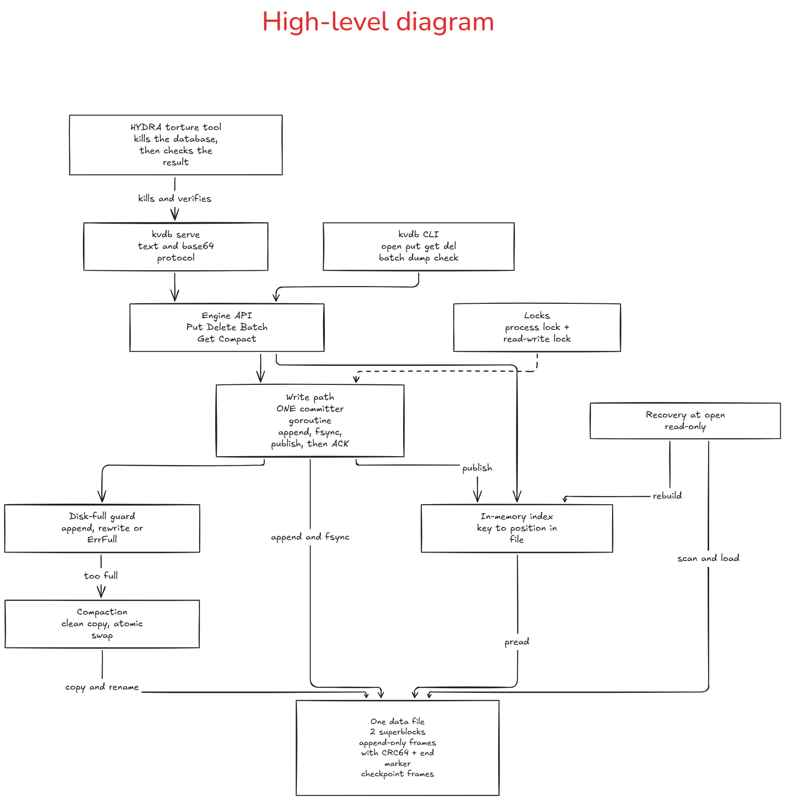
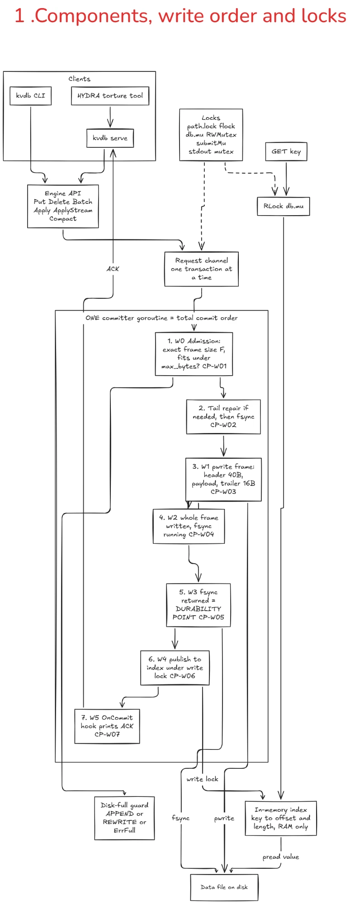
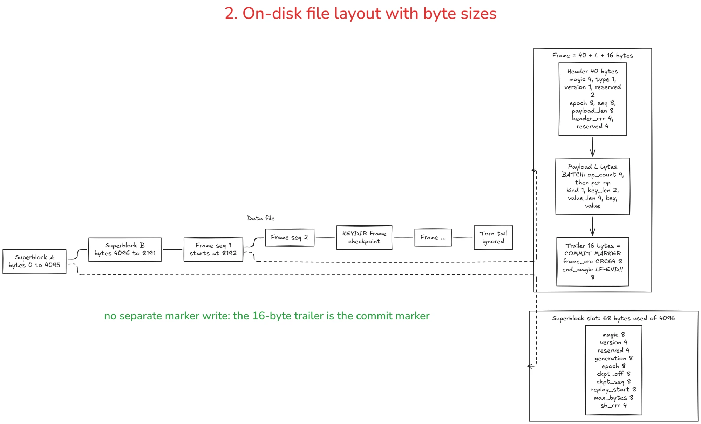
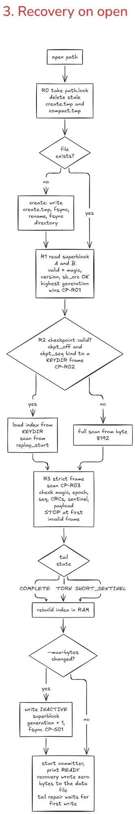
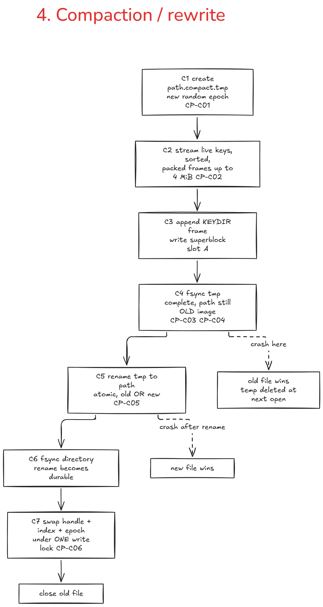
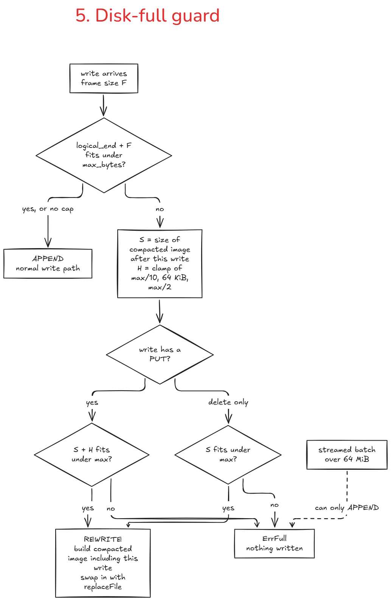

# ARCHITECTURE — LEAPFROG-R

> **Owner:** Tanushree-RD. Skeletons established at T0, expanded at T2/T3, final at T4/T5. Every claim must match the code. The judge checks three random rows of the proof table against the source during the demo.

---

## Part 1 — Architecture diagram

### Figure 1: High-level architecture



How to read it:
- Clients (the `kvdb` CLI and `kvdb serve`) go through one engine API into **one committer**, so every write has a single order.
- A write is: append the frame, `fsync`, publish to the in-memory index, then ACK.
- The data lives in **one file** (two superblocks, append-only frames with a CRC64 and an end marker, checkpoint frames). The index is in RAM only.
- Recovery rebuilds the index from the file, compaction rewrites the file, and the disk-full guard decides append, rewrite or `ErrFull` before any byte is written.
- HYDRA kills `kvdb serve` at random moments and checks that nothing ACKed was lost.

### Figure 2: Low-level architecture

The detailed view, in five parts.

#### 2a. Components, write order and locks



The numbered boxes 1 to 7 are the order of one write. Step 5 (`fsync` returns) is the durability point; the ACK is printed only at step 7.

#### 2b. On-disk file layout with byte sizes



There is no separate commit-marker write: the 16-byte frame trailer (`frame_crc` CRC64 + `LF-END!!`) is the commit marker, and one `fsync` covers the whole frame.

#### 2c. Recovery on open



Recovery writes zero bytes to the data file. Stale temp files (including a half-done compaction) are deleted, the best superblock is chosen, the checkpoint is loaded or a full scan is done, and the scan stops at the first invalid frame.

#### 2d. Compaction / rewrite



The replacement file is built and `fsync`ed first, then `rename` swaps it in atomically. A crash before the rename leaves the old file authoritative; a crash after it leaves the new one.

#### 2e. Disk-full guard



- Before any byte is written, the committer checks `logical_end + F <= max_bytes` (CP-W01). If it fits, the write is **appended**.
- If it does not fit, it computes `S` (size of the compacted image after the write) and the headroom `H = clamp(max/10, 64 KiB, max/2)`. A write with a put needs `S + H <= max`; a delete-only write needs `S <= max`. Then it does a **rewrite**: a compacted image including this write, swapped in with the same `replaceFile()` as compaction (2d).
- Otherwise the result is `ErrFull`, and nothing was written. A streamed batch (`ApplyStream`, over 64 MiB) can only append.

### Text version of the same flow

```
CLI / serve ──► engine API (src/engine/api.go)
  PUT / DEL / BATCH / COMPACT ─► request channel ─► ONE committer goroutine (total commit order)
                                                     W0 validate + exact size + admission: APPEND | REWRITE | FULL   (CP-W01)
                                                        tail repair if needed (first write after open)                (CP-W02)
                                                     W1 stream the frame to disk with an incremental CRC              (CP-W03)
                                                     W2 whole frame present, fsync running                            (CP-W04)
                                                     W3 fsync returned  ◄── DURABILITY POINT                          (CP-W05)
                                                     W4 published under index write lock                              (CP-W06)
                                                     W5 OnCommit hook: serve prints + flushes "ACK id"                (CP-W07)
                                                     ...only then does the committer take the next transaction
  GET ─► RLock ─► map[key]→(off,len) ─► pread from current file ─► RUnlock

DISK  [ SB-A 4 KiB ][ SB-B 4 KiB ][ frame ][ frame ]...[ KEYDIR ][ frame ]...│torn tail?│
      0            4096          8192                                 logical_end

RECOVERY  lock → clean temps → pick superblock → load checkpoint (seq + replay_start) or full scan
          → scan frames strictly → stop at first invalid → rebuild index → ready   (writes no bytes)
          → only if `--max-bytes` changes the persisted cap: inactive-superblock update (7.4)

COMPACTION / REWRITE  build path.compact.tmp (live keys only) → fsync → rename → fsync dir
                      → swap file handle + index + metadata under write lock → close old file

PROCESS OWNERSHIP  flock on path.lock (never on the data file itself)
```

---

## Part 1b — Persistence-order graphs and state machines

### Persistence rules P1 to P4
- **P1:** Never publish an index entry or file handle that points at bytes until those bytes are durable.
- **P2:** Never retire the old authoritative image until the replacement is complete and durable.
- **P3:** Never expose a mixed generation: file handle, index offsets, epoch and logical metadata are published under **one** write lock.
- **P4:** Never append behind an invalid tail: truncate a TORN tail, or restore a SHORT_SENTINEL, and fsync first.

### Write path graph and W0 to W5
```
frame bytes ──fsync──► index publish ──► OnCommit/ACK
```
- **W0:** Validated and admitted; no bytes written (tail repair may run) [CP-W01, CP-W02]
- **W1:** Frame being streamed to disk [CP-W03]
- **W2:** Whole frame present; fsync running [CP-W04]
- **W3:** fsync returned; not yet published [CP-W05]
- **W4:** Published to index; ACK not yet emitted [CP-W06]
- **W5:** ACK flushed by OnCommit hook [CP-W07]

### Checkpoint and cap-change graph and S0 to S2
```
checkpoint:  KEYDIR frame ──fsync──► inactive superblock (ckpt_off, ckpt_seq, replay_start) ──fsync──► slot is current
cap change:  (recovery done) ──► inactive superblock (max_bytes) ──fsync──► slot is current
```
- **S0:** KEYDIR fsynced (checkpoint) or recovery finished (cap change)
- **S1:** Inactive slot being written [CP-S01]
- **S2:** New slot fsynced; active

### Compaction graph and C0 to C4
```
tmp image (superblock + frames + KEYDIR) ──fsync(tmp)──► rename ──fsync(dir)──► locked swap ──► close old
```
- **C0:** Old image only
- **C1:** Temp partial or unsynced [CP-C01, CP-C02]
- **C2:** Temp complete and fsynced [CP-C03, CP-C04]
- **C3:** Rename done; process on old view [CP-C05]
- **C4:** Handle + index + epoch swapped together [CP-C06]

### Recovery R0 to R3
- **R0:** Lock held, temps cleaned
- **R1:** Superblock chosen [CP-R01]
- **R2:** Checkpoint loaded or fallback chosen [CP-R02]
- **R3:** Tail scanned, index built [CP-R03]

---

## Part 2 — Scenario-to-mechanism proof table (all 32 rows)

| ID | Scenario | Disk state at the kill | Mechanism | Where in the code | Verified by |
| --- | --- | --- | --- | --- | --- |
| A1 | Kill before write | Nothing new | Admission before any write (CP-W01) | `src/engine/commit.go:commit` | `sweep --cp CP-W01` |
| A2 | Kill mid-write | Partial frame | Length/CRC64 check fails; whole frame ignored | `src/engine/recover.go:scanFrom` | `sweep --cp CP-W03`, fixture `torn-payload` |
| A3 | Kill before fsync | Complete frame, not fsynced | Valid frame may appear; never ACKed | `src/engine/commit.go:commit` | `sweep --cp CP-W04` |
| A4 | Kill after fsync | Frame fsynced, no return yet | Durable valid frame recovered | `src/engine/commit.go:commit` | `sweep --cp CP-W05` |
| A5 | Kill after ACK | ACKed | Durable valid frame recovered | `src/cmd/kvdb/serve.go:runServe` | `default`, `sweep --cp CP-W07` |
| A6 | Delete crash | Delete frame in any state | Same as A1 to A5 (delete = one-op batch) | `src/engine/commit.go:commit` | `default` |
| A7 | Large value crash | Partial 1 MiB frame | Header CRC bounds L; CRC64 covers every byte | `src/engine/frame.go:ScanFrame` | `large-values`, `sweep --cp CP-W03` |
| B1 | Batch partial 1 | 3 of 10 ops written | One frame, incomplete, so ignored | `src/engine/recover.go:scanFrom` | `sweep --cp CP-W03`, fixture `torn-payload` |
| B2 | Batch partial 2 | All ops, no CRC64 | Missing CRC64, so none visible | `src/engine/frame.go:ScanFrame` | `sweep --cp CP-W03`, fixture `missing-crc` |
| B3 | Batch unfsynced | CRC64 written, not fsynced | Whole frame valid or torn: all or none | `src/engine/commit.go:commit` | `sweep --cp CP-W04` |
| B4 | Batch ACKed | Batch ACKed | All ops recovered | `src/engine/commit.go:commit` | `default` |
| B5 | In-batch overwrite | PUT X then DEL X | Apply in order; last wins | `src/engine/payload.go:ParseBatch` | `tests/batch_test.go:TestBatchB5Ordering`, `micro` trace T5 |
| B6 | 10k batch crash | Half of a 10k-op frame | Incomplete, so ignored; recovery timed | `src/engine/recover.go:scanFrom` | `large-batches` |
| C1 | Recovery crash 1 | Unchanged | Recovery writes no bytes | `src/engine/db.go:Open` | `recovery-crash`, `sweep --cp CP-R01` |
| C2 | Recovery crash 2 | Unchanged | Repair deferred to first write | `src/engine/commit.go:repairTail` | `recovery-crash`, `sweep --cp CP-W02` |
| C3 | Compaction crash | Old file + partial or complete temp | Old file authoritative; temp deleted | `src/engine/db.go:Open` | `compaction`, `sweep --cp CP-C02`, fixture `stale.compact-tmp` |
| C4 | Rename crash | Old or new image at path | rename is atomic | `src/engine/compact.go:replaceFile` | `compaction`, `sweep --cp CP-C04`, `sweep --cp CP-C05` |
| C5 | Post-rename crash | New image + no temp | New image authoritative | `src/engine/compact.go:replaceFile` | `compaction`, `sweep --cp CP-C05`, `sweep --cp CP-C06` |
| C6 | Close crash | Same as any write | close = stop committer + fsync | `src/engine/db.go:Close` | `--mode fixtures` case `clean-close` (EOF after 3 ACKed requests: all keys and 3 frames present, `check` OK); a kill during close is the same as any write (default, sweep) |
| D1 | Concurrent lanes | Frames from two lanes | One committer serializes whole transactions | `src/engine/commit.go:committer` | `default` |
| D2 | Same key conflict | Two frames, same key | Each frame atomic; value names exactly one writer | `src/engine/commit.go:committer` | `default`, `tests/concurrent_test.go:TestACKOrderMatchesCommitOrder` |
| D3 | Mixed batch & singles | Big batch + singles | Independent serialized transactions | `src/engine/commit.go:committer` | `large-batches` |
| D4 | Concurrent read | No crash | One write-locked publication; RLock across pread | `src/engine/db.go:MultiGet` | `tests/concurrent_test.go:TestD4ConcurrentReaderNoPartialBatch` |
| E1 | Disk-full put | Nothing new | ErrFull before any write | `src/engine/commit.go:commit` | `disk-full`, `tests/diskfull_test.go:TestDiskFullPersistedCap` |
| E2 | Disk-full batch | Nothing new | Whole batch admitted or rejected | `src/engine/commit.go:commit` | `disk-full`, `tests/diskfull_test.go:TestDiskFullPersistedCap` |
| E3 | Disk-full prior data | Old image intact | Same as A5 for prior data | `src/engine/commit.go:commit` | `disk-full`, `tests/diskfull_test.go:TestDiskFullPersistedCap` |
| E4 | ENOSPC in compaction | Old file + temp | Temp ≤ cap by precheck; ENOSPC means poison, old intact | `src/engine/compact.go:replaceFile` | precheck half: `--mode fixtures` case `compact-refused-at-small-cap` (FULL, no temp created, file byte-identical); write-error half: cases `write-error-exits-3-data-intact` and `write-error-then-put` (a failing write, forced with a file-size limit that takes the same error path as ENOSPC: `ERR <id> IO`, exit 3, nothing ACKed afterwards, ACKed data intact, torn tail repaired by the next write); real ENOSPC on a full disk: not verified |
| E5 | Space reclamation | Image shrinks | Delete-through-rewrite | `src/engine/admission.go:rewriteOrFull` | `disk-full`, `tests/compact_test.go:TestCompactShrinksFile` |
| F1 | General torture | Any | All of the above | `src/engine/db.go:Open` | `default` (500 iterations) |
| F2 | Repeated crash | Unchanged | Read-only recovery is idempotent | `src/engine/recover.go:scanFrom` | `recovery-crash` |
| F3 | Fast recovery | Checkpoint + short tail | KEYDIR bounds the scan | `src/engine/recover.go:loadCheckpoint` (KEYDIR written by `checkpoint.go:checkpoint`) | `tests/benchmark_test.go:TestBenchF3Recovery` |
| F4 | Truncated sentinel | Last byte of end_magic missing | Short-sentinel rule keeps the ACKed frame | `src/engine/frame.go:ScanFrame` | `tests/f4_test.go:TestF4OneByteTruncationSentinel`, fixture `short-sentinel-1` |

---

## Part 3 — The three guarantees

### Durability
- Put, Delete, Batch, and Apply return success only after the committer's `pwrite` of the transaction's frame and a successful `fsync` of the data file.
- On the rewrite path, success comes only after the replacement file's `fsync`, `rename`, and directory `fsync`.
- `serve` prints `ACK` only from the committer's `OnCommit` hook, running after publish, in commit order.
- On any I/O failure, the handle is poisoned and the caller receives `ErrIO`. We never retry a failed `fsync`.

### Atomicity
- A batch is serialized into exactly one frame.
- Recovery validates magic, type, version, header CRC, epoch, exact sequence number, length bounds, full frame CRC64, structural sentinel, and exact payload parse.
- Any altered or missing byte causes the entire frame to be rejected; zero ops apply.
- In-memory publication updates the entire batch under a single index write lock.

### Recoverability
- `open()` performs zero writes to the database data file.
- Tail repair (truncation or sentinel restoration) is strictly deferred to the first write transaction.
- File creation and compaction always use temporary files atomically renamed after fsync.
